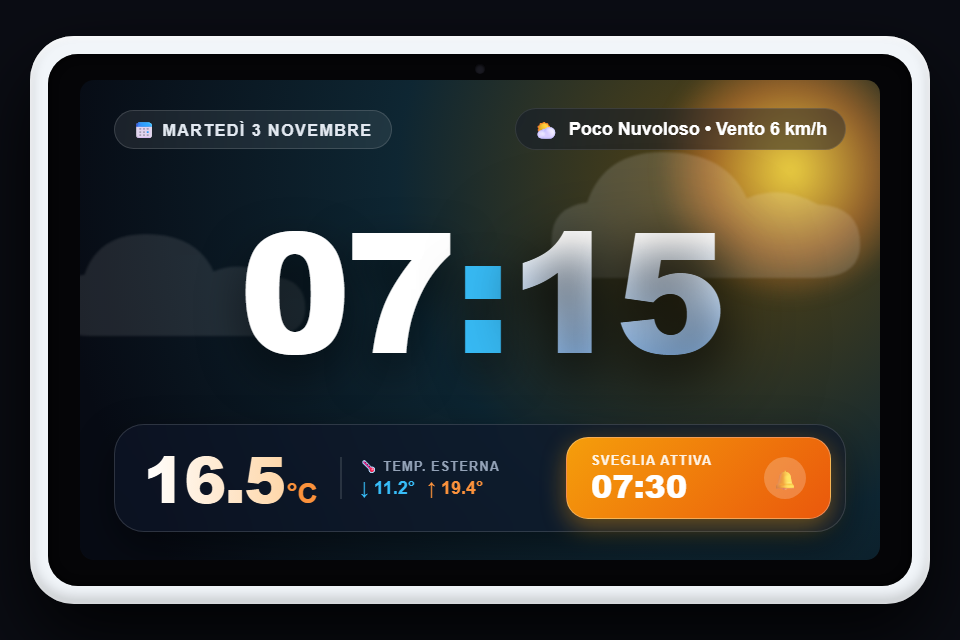
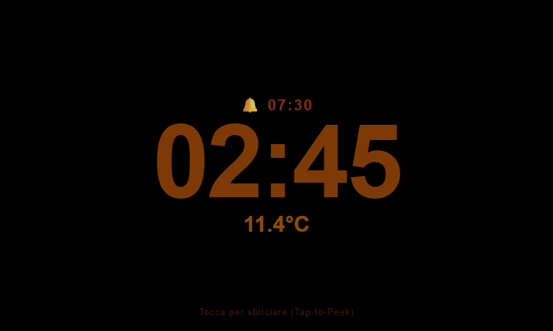
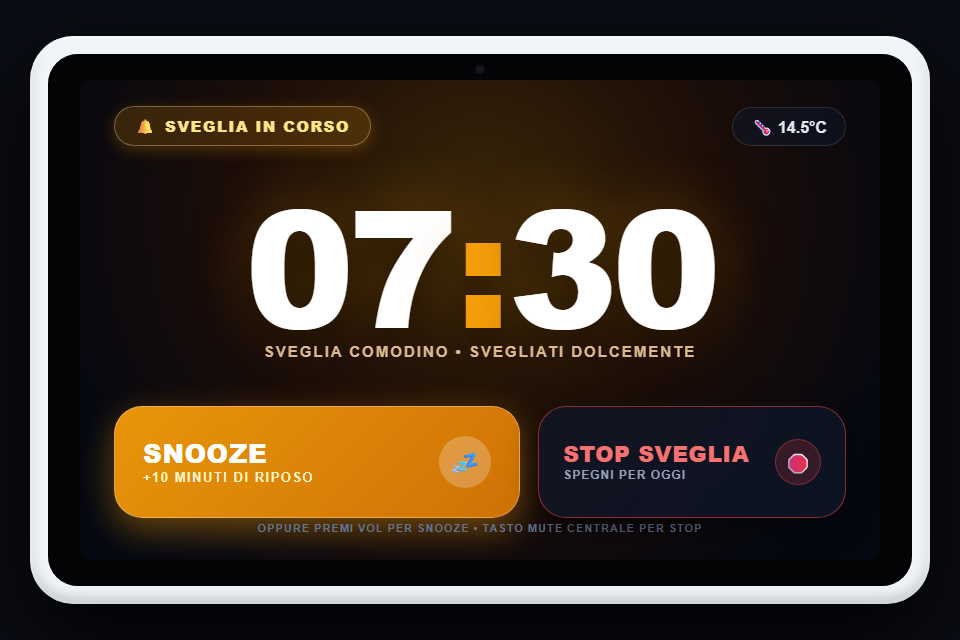
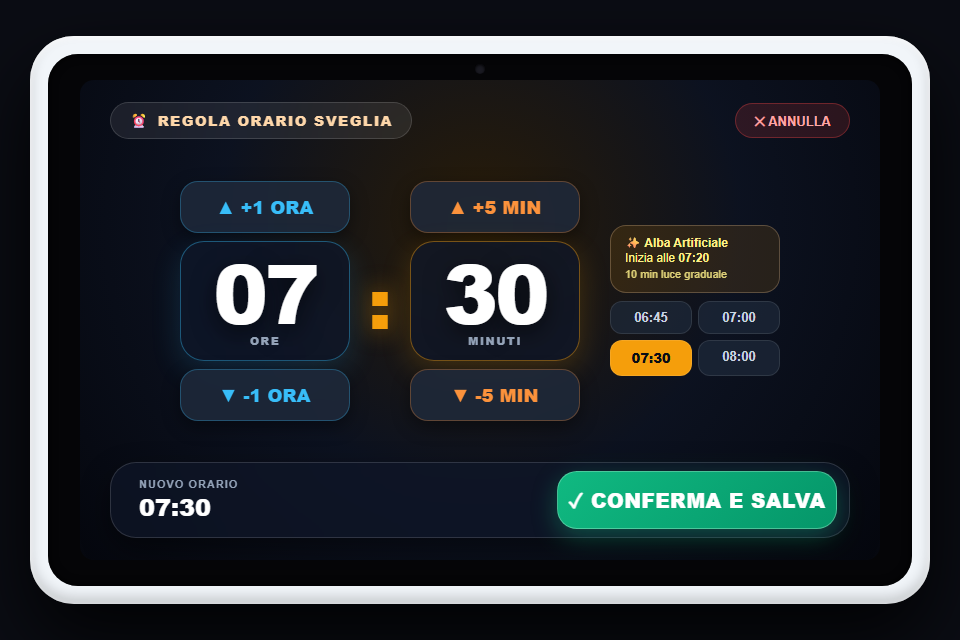

# Aura Clock ✨ • Smart Bedside Kiosk

<div align="center">

-3DDC84?logo=android&logoColor=white)
-FF6900?logo=xiaomi&logoColor=white)


**La sveglia smart e cruscotto da comodino ad altissima affidabilità (WAF 100%) per Xiaomi Mi Smart Clock (MT8167S).**  
Architettura ibrida a 4 layer, sveglia locale offline-safe al 100%, comfort notturno ambra a zero luce blu e design diurno dinamico *"Living Weather Horizon"*.

</div>

---

## 📸 Schermate dell'Applicazione

### ☀️ Modalità Diurna: "Living Weather Horizon" (Layer 1)
Cielo a tutto schermo animato dinamicamente in base alle condizioni meteorologiche reali, orologio gigante centrale ad alta leggibilità e Dock inferiore satinata con temperatura esterna min/max e card stato sveglia.

<div align="center">
  
</div>

---

### 🌙 Modalità Notte: Ambra Caldo Anti-Luce Blu (Layer 2)
Al buio profondo (< 2 lux), l'orologio riduce la retroilluminazione all'1% hardware e attiva l'overlay nativo nero puro `#000000` con caratteri ambra caldo `#B45309`, rispettando il ritmo circadiano. Include protezione anti burn-in con pixel-shift ciclico.

<div align="center">
  
</div>

---

### ⏰ Sveglia Attiva & Selettore Rapido Orario (Layer 3 & Vista Lovelace)
Pulsantoni gigante Snooze (+10 min) e Stop all'attivazione dell'allarme hardware, con suoneria progressiva in Fade-In. È possibile impostare o modificare l'orario della sveglia direttamente dal comodino con incrementi orari e di 5 minuti.

<div align="center">
  
  &nbsp;&nbsp;
  
</div>

---

### 🛠️ Pannello Configurazione & Setup On-Device (Layer 4)
Overlay nativo accessibile al primo avvio o in qualsiasi momento con un gesto segreto (5 tap rapidi nell'angolo superiore sinistro): consente di impostare l'URL di Home Assistant, il token di accesso, lanciare le impostazioni Wi-Fi di sistema e visualizzare la diagnostica live (IP, Lux, WebSocket, Prossima Sveglia) direttamente dal touchscreen.

---

## 🌟 Caratteristiche Principali

- **Affidabilità Critica 100% Offline-Safe**: La sveglia usa `AlarmManager.setAlarmClock()` nativo e riproduce un file audio locale progressivo (`assets/gentle_alarm.mp3`) in loop. Suonerà puntuale anche a router spento, server Home Assistant offline o dopo un riavvio hardware improvviso.
- **Zero Schermate di Errore o Login**: Nessun banner di errore WebView (`net::ERR_CONNECTION_REFUSED`) o form di login HA. In caso di blackout, l'app passa silenziosamente sul Layer 2 Ambra e un worker periodico in background ripristina la dashboard non appena Home Assistant torna raggiungibile.
- **Hysteresis Anti-Accecamento**: Macchina a stati con debounce asimmetrico: entra in modalità notte dopo 5 secondi continui di buio (< 2 lux) ed esce solo dopo 8 secondi continui di luce (> 8 lux), evitando che l'accensione di uno smartphone al buio abbagli la stanza.
- **Tap-to-Peek Notturno**: Toccando lo schermo al buio, la dashboard Lovelace viene mostrata con un filtro caldo anti-luce blu (`sepia(45%) hue-rotate(-15deg) brightness(85%)`) e luminosità al 12% per 15 secondi, permettendo di controllare la casa o regolare la sveglia senza affaticare gli occhi.
- **Alba Artificiale (Sunrise)**: Nei 10 minuti precedenti la sveglia, lo schermo sfuma gradualmente dal nero a un gradiente ambra/oro portando la luminosità dall'1% all'80%.
- **Mappatura Hardware Tasti Fisici**: I tasti fisici superiori dello Xiaomi Mi Smart Clock (VOL+, VOL-, MUTE) sono intercettati contestualmente.

---

## 🏗️ Architettura Ibrida a 4 Layer

```
+-----------------------------------------------------------------------------------+
|                              MAIN ACTIVITY (800x480 px)                           |
|                                                                                   |
|  [ LAYER 4: Settings / Provisioning Overlay (Visibile su 5-tap o primo avvio)  ]  |
|  [ LAYER 3: Alarm Ringing Native UI (Visibile quando la sveglia suona)         ]  |
|  [ LAYER 2: Night & Offline Native Overlay (Nero puro #000000 + Ambra Caldo)   ]  |
|  [ LAYER 1: Android WebView -> Layout "Living Weather Horizon" a 60 fps        ]  |
+-----------------------------------------------------------------------------------+
        ^                        ^                         ^                 ^
        |                        |                         |                 |
+-------+------------------------+-------------------------+-----------------+------+
|                      FOREGROUND SERVICE ("AuraClockCoreService")                  |
|                                                                                   |
|  • AppConfig (SharedPreferences unificate per parametri e cache stati)       |
|  • HaWebSocketClient (OkHttp WebSocket: Auth Bearer, State Sync, Service Calls)   |
|  • LightSensorController (Sensor.TYPE_LIGHT, Debounce 5s/8s + Hysteresis)         |
|  • ReliableAlarmManager (AlarmManager.setAlarmClock + MediaPlayer Fade-In)        |
|  • HardwareKeyHandler (Intercettazione fisica VOL_UP, VOL_DOWN, KEY_MUTE)         |
+-----------------------------------------------------------------------------------+
```

---

## 🎛️ Mappatura Tasti Fisici Superiori

| Contesto Dispositivo | Tasto VOL_UP (24) | Tasto VOL_DOWN (25) | Tasto Centrale MUTE (91 / 131 / 164) |
| :--- | :--- | :--- | :--- |
| **Sveglia che suona (Layer 3)** | SNOOZE (+10 min) | SNOOZE (+10 min) | STOP Definitivo Sveglia |
| **Modalità Notte (Layer 2)** | Attiva Tap-to-Peek (15s) | Attiva Tap-to-Peek (15s) | `light.toggle` Luce Comodino |
| **Modalità Giorno / Peek attivo** | Luminosità +15% | Luminosità -15% | `light.toggle` Luce Comodino |

---

## 🚀 Installazione e Deployment

### 1. Requisiti Hardware & Firmware
- **Dispositivo**: Xiaomi Mi Smart Clock (Modello Globale X04G).
- **Sistema Operativo**: Android 9.0 Pie / LineageOS 16.0 (API Level 28) con Android System WebView aggiornata (min v110+).

### 2. Installazione APK via ADB
Il file APK di debug già compilato è disponibile in `app/build/outputs/apk/debug/app-debug.apk`.

È possibile installarlo tramite lo script PowerShell dedicato:
```powershell
# Via cavo USB:
.\deploy.ps1

# Via Wi-Fi ADB (se attivo sull'orologio):
.\deploy.ps1 -DeviceIp 192.168.1.145
```

---

## 🏡 Configurazione Home Assistant

Tutti i file di backend e frontend si trovano nella cartella [`homeassistant/`](homeassistant):

1. **Backend (`homeassistant/configuration.yaml`)**:
   - Aggiungere al proprio `configuration.yaml` i sensori di sistema (`sensor.time`), gli helpers sveglia (`input_boolean.sveglia_comodino_attiva`, `input_datetime.sveglia_comodino_orario`), lo script di regolazione e il sensore Min/Max.
2. **Dashboard (`homeassistant/dashboard_living_weather_horizon.yaml`)**:
   - Installare via HACS: `custom:button-card`, `custom:layout-card`, `kiosk-mode`.
   - Creare una dashboard dedicata `/lovelace-comodino` e incollare il layout.
3. **Generazione Token**:
   - Creare un Long-Lived Access Token su Home Assistant e inserirlo in Aura Clock tramite l'overlay di setup su schermo (5 tap veloci nell'angolo superiore sinistro).

---

## 📦 Struttura del Repository

```
AuraClock/
├── app/
│   ├── src/main/
│   │   ├── java/com/custom/auraclock/
│   │   │   ├── MainActivity.kt                # Coordinatore 4 Layer, WebView, Touch e KeyEvents
│   │   │   ├── AuraClockCoreService.kt        # Foreground Service (WebSocket, Sveglia, Notifiche)
│   │   │   ├── BootReceiver.kt                # Ripristino al riavvio del dispositivo
│   │   │   ├── config/                        # AppConfig (SharedPreferences unificate)
│   │   │   ├── network/                       # HaWebSocketClient (OkHttp WebSocket)
│   │   │   ├── hardware/                      # LightSensorController & HardwareKeyHandler
│   │   │   └── alarm/                         # ReliableAlarmManager, AlarmReceiver, AlarmAudioPlayer
│   │   ├── res/                               # Layouts, colori ambra, stili e stringhe
│   │   └── assets/                            # gentle_alarm.mp3 (suoneria locale)
├── docs/screenshots/                          # Screenshot per GitHub / Codeberg
├── homeassistant/                             # Configurazione YAML e dashboard Lovelace
├── deploy.ps1                                 # Script di deployment automatico ADB
└── README.md
```

---

## 📄 Licenza

Rilasciato sotto licenza MIT. Libero per uso personale e modifiche.
